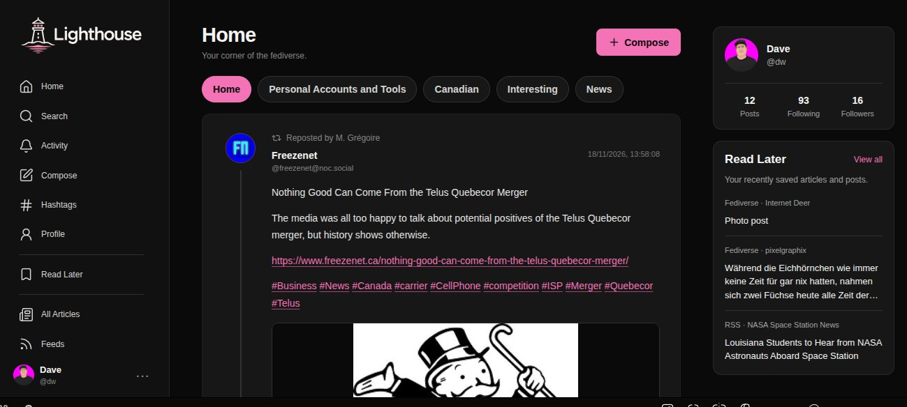
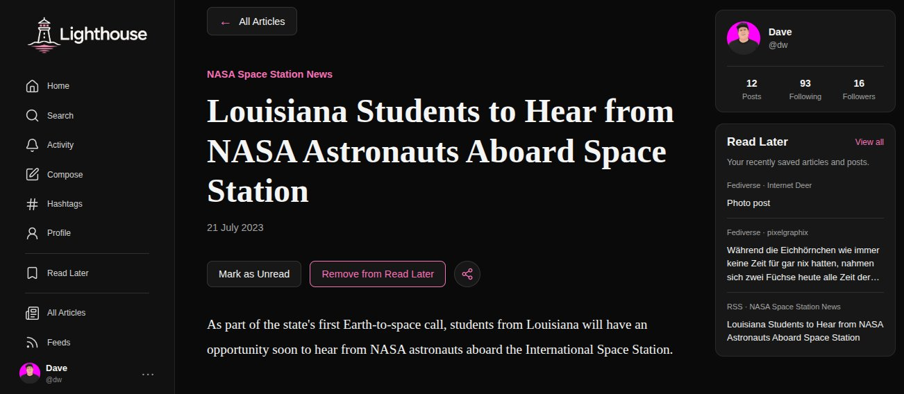
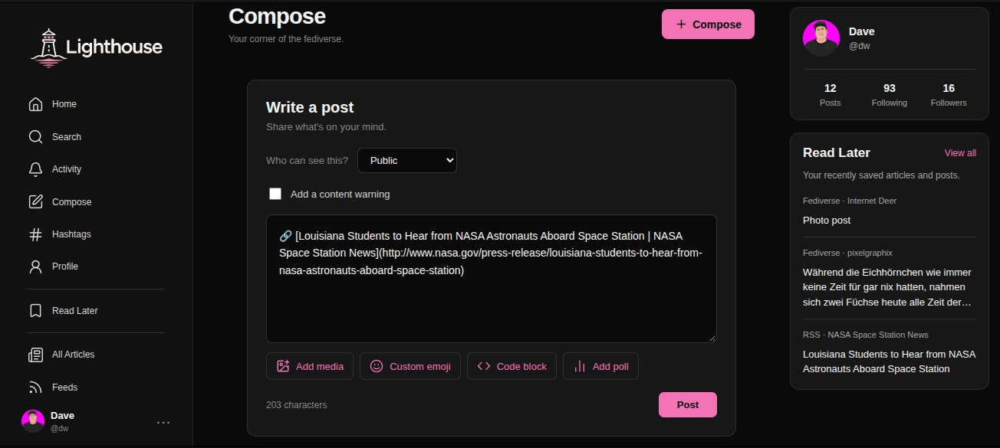
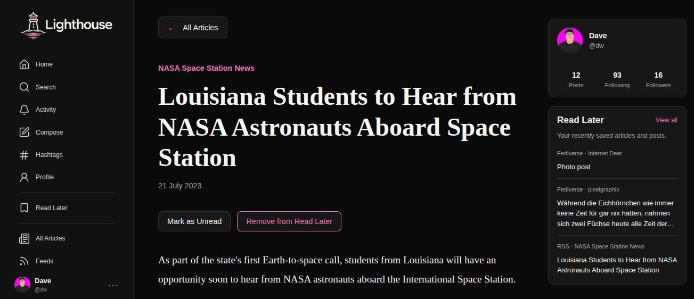
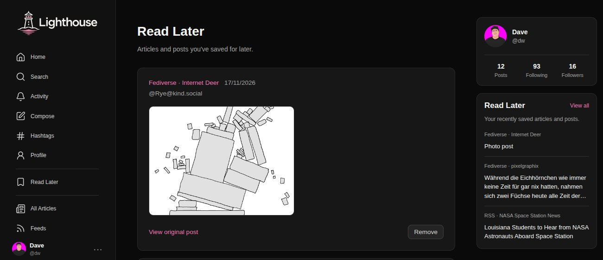
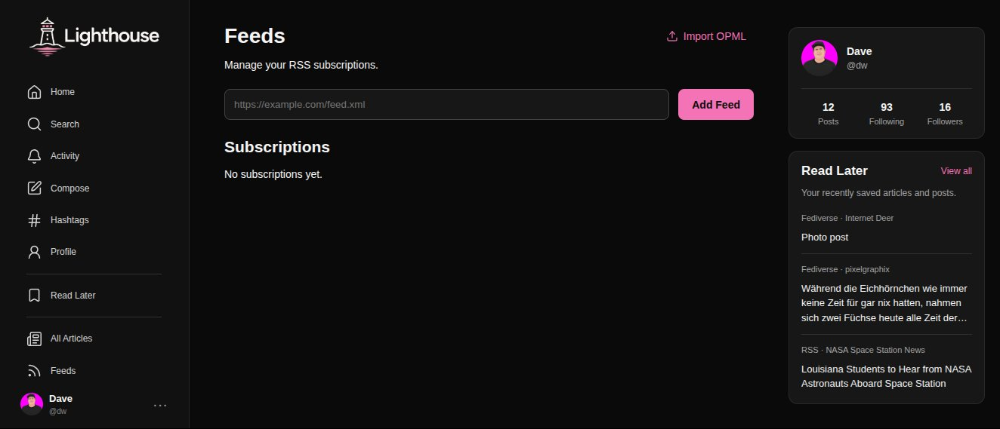

# Lighthouse

**A personal home for the Fediverse and RSS.**

Lighthouse is a lightweight, self-hosted web application that brings a Fediverse timeline and RSS feed reading together in one interface.

I built it primarily for myself, concentrating on the features I use rather than trying to make a comprehensive social networking client or feed reader. I love RSS and feed readers: they're a way to follow the web directly, without having an algorithm choose what matters. Lighthouse puts that reading alongside the Fediverse conversations I follow.

## Screenshots

### Fediverse home



### RSS articles



### Fediverse composer



### Article reader



### Read Later



### Feed subscriptions



## Features

### Fediverse

- Home and list timelines
- Notifications and follow requests
- Followed hashtag timelines
- Composing posts and interacting with posts
- Images, video, polls and bookmarks
- Basic account search and follow controls

### RSS

- Subscribe to RSS and Atom feeds
- Import subscriptions from OPML
- Browse articles and read them in a dedicated reader
- Save articles for later
- Remove subscriptions while retaining saved articles

### Together

- One responsive interface for the Fediverse and RSS
- A shared Read Later view with Fediverse bookmarks and saved RSS articles

## Article sharing and link sanitization

Lighthouse lets you share RSS articles directly to the Fediverse.

The Share button in the article reader opens the existing composer with a prefilled Markdown link:

`🔗 [Article Title | Feed Name](https://example.com/article)`

You can edit the draft before publishing. Nothing is posted automatically.

### Clean links

Lighthouse automatically removes common tracking parameters from URLs when:

- Sharing an RSS article to the Fediverse composer.
- Copying a Fediverse post link.

The sanitizer removes known tracking identifiers such as `utm_*`, `fbclid`, `gclid`, and `msclkid`, while preserving other query parameters that may be necessary for the link to work.

The original RSS article URL remains unchanged. This is a conservative tracking-parameter cleaner rather than a comprehensive privacy-filtering service.

## Appearance

Lighthouse uses my **Noctiluna colour scheme**: near-black backgrounds, dark surfaces, soft pink and purple accents, and off-white text.

- [Noctiluna colour scheme](https://github.com/luchadave/noctiluna-colourscheme)

The interface uses Manrope for UI text, Source Serif 4 for articles, and IBM Plex Mono for code.

## Requirements

- Node.js 24 and npm for local development
- A Hollo instance with an OAuth application registered for Lighthouse
- Persistent storage for the session and RSS SQLite databases

Lighthouse has been developed and tested with **Hollo**. Compatibility with other Fediverse backends has not been verified.

## Local development

Clone the Lighthouse repository once it is published, then install dependencies:

```bash
npm ci
```

Create a `.env.local` file with your Hollo OAuth settings:

```dotenv
HOLLO_BASE_URL=https://your-hollo-instance.example
HOLLO_CLIENT_ID=your-client-id
HOLLO_CLIENT_SECRET=your-client-secret
HOLLO_REDIRECT_URI=http://localhost:5174/auth/callback
HOLLO_SESSION_SECRET=replace-with-a-long-random-secret
LIGHTHOUSE_DATABASE_PATH=./data/lighthouse-sessions.db
LIGHTHOUSE_RSS_DATABASE_PATH=./data/lighthouse-rss.db
```

The redirect URI must match the value registered with your Hollo instance.

```bash
npm run dev
```

Open `http://localhost:5174`. To validate or build:

```bash
npm run check
npm run build
```

## Container deployment

The project includes a multi-stage `Dockerfile` and `compose.yaml`. For production, create an untracked `.env.production` with your OAuth configuration and database paths pointing into the persistent `/data` directory:

```dotenv
LIGHTHOUSE_DATABASE_PATH=/data/lighthouse-sessions.db
LIGHTHOUSE_RSS_DATABASE_PATH=/data/lighthouse-rss.db
```

Also configure `HOLLO_BASE_URL`, `HOLLO_CLIENT_ID`, `HOLLO_CLIENT_SECRET`, `HOLLO_REDIRECT_URI` and `HOLLO_SESSION_SECRET` for the deployed instance. Register the production callback URL with Hollo.

The supplied Compose configuration expects an existing external Docker network named `hollo_default`, shared with a reverse proxy. Adapt this for your own deployment. The Compose file also expects `.env.production` to be present.

Do not commit environment files containing secrets, database files, or tokens.

## Scope and limitations

Lighthouse is a personal project with a deliberately limited feature set. It isn't intended to replace a fully featured Fediverse client or dedicated RSS reader. Some features are basic or incomplete, and it has only been tested against Hollo.

I'm not planning ongoing feature development beyond my own needs. If Lighthouse suits you too, you're welcome to use it, adapt it, or fork it.

## License

Lighthouse is released under the [MIT License](LICENSE).
